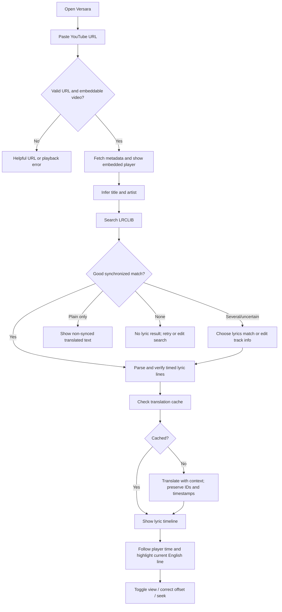
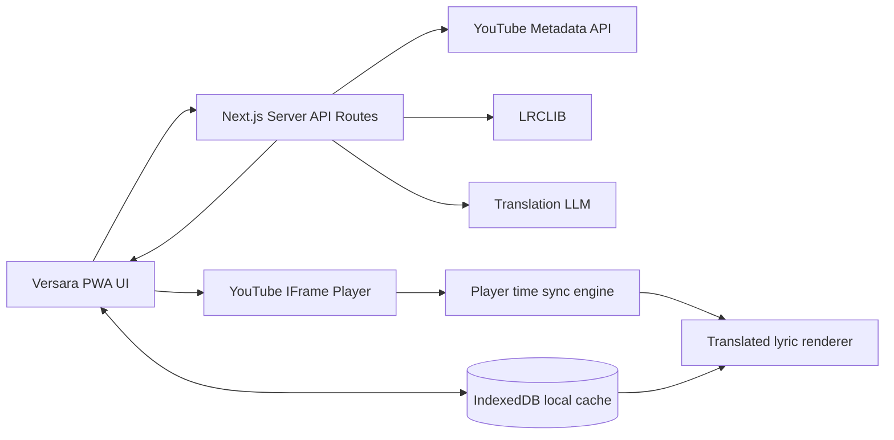

# Versara — Product Requirements Document (PRD)

**Version:** 1.0 — MVP specification  
**Product:** Versara  
**Tagline:** *Feel the music. Understand every word.*  
**Product type:** Mobile-first, installable Progressive Web App (PWA)  
**Audience:** One personal user; no account system  
**Design language:** Minimal dark claymorphism (soft, tactile, rounded interfaces)  
**Design workflow:** Google Stitch → code handoff → Codex implementation  
**Status:** Ready for UI design and MVP implementation; no code requested yet

---

## 1. Executive summary

Versara lets a user paste a YouTube song URL, load the video in an embedded player, detect the track title and artist, search LRCLIB for synchronized lyrics, translate the meaning of those lyrics into natural English, and show the correct translated line while the song is playing.

The app must feel like a small, elegant music app, not a technical AI dashboard. It should be enjoyable to use on a phone, installable through **Add to Home Screen**, and equally usable in a desktop browser.

**Core experience:**

`Paste YouTube link → Recognize track → Match LRCLIB lyrics → Context-aware English translation → Play and read synchronized lyrics`

**MVP product promise:** For a compatible YouTube video with a correct timestamped LRCLIB match, the user can understand the currently sung line in natural English without managing timestamps manually.

### 1.1 Goals

1. Convert a supported YouTube song link to a usable listening-and-translation experience with minimal interaction.
2. Keep translated lyric lines synchronized with embedded video playback, including pause, resume, seeking, and replay.
3. Preserve lyrical meaning, emotion, and metaphors rather than producing mechanical word-by-word translations.
4. Prioritize simple, calm, responsive design using restrained claymorphism.
5. Make Versara installable as a standalone PWA on supported mobile and desktop browsers.
6. Preserve successful results locally so previously translated songs reopen quickly.

### 1.2 Non-goals for v1

No authentication; no recommendations, social features, comments, subscriptions, downloads of YouTube audio, user-uploaded music, karaoke vocal separation, automatic speech recognition fallback, full offline music playback, playlist creation, or word-by-word karaoke highlighting.

### 1.3 Product assumptions

- The user supplies a YouTube watch, short, or share URL containing a usable video ID; YouTube Shorts can be rejected gracefully if they do not behave as expected as songs.
- The app uses a visible, official YouTube embedded player for playback.
- LRCLIB is the initial lyric source. Not all songs have synchronized lyrics.
- One configured LLM/translation API key is available on the server (never exposed to the client).
- English is the only target translation language for v1.
- The app runs over HTTPS in production, with localhost for development.

---

## 2. Target user and experience

**Persona:** A music listener who discovers Japanese, Korean, Hindi, Bangla, Spanish, and other-language songs on YouTube and wants to understand what is being sung while listening.

**Primary user story:**
> As a listener, I want to paste a YouTube music link and see a meaningful English translation highlighted at the corresponding sung line, so I can follow the song without switching apps.

**Secondary user stories:**
- As a user, I can toggle among **Both**, **English**, and **Original** without interrupting playback.
- As a user, I can adjust the subtitle timing when the YouTube version has an intro or differs from the LRCLIB recording.
- As a user, I can correct automatically detected track metadata and choose an alternate LRCLIB result.
- As a user, I can reopen a recent song without reentering its URL or repeating a successful translation.
- As a phone user, I can install Versara to my home screen and open it as an app.

### 2.1 User flow



---

## 3. Functional requirements

Priorities: **P0** required for first usable release; **P1** strong v1 enhancement; **P2** future.

| ID | Priority | Requirement | Acceptance condition |
|---|---|---|---|
| FR-01 | P0 | Paste URL | Accept `youtube.com/watch?v=`, `youtu.be/`, and supported `music.youtube.com/watch?v=` URLs; trim whitespace and reject invalid IDs. |
| FR-02 | P0 | Embedded playback | Load a visible YouTube iframe player for the selected video; reflect play, pause, and seek. |
| FR-03 | P0 | Song identification | Retrieve video title and available metadata; infer track name and artist; show editable detected values. |
| FR-04 | P0 | Lyrics retrieval | Search LRCLIB, prefer timestamped lyrics, and handle absent/ambiguous results. |
| FR-05 | P0 | Candidate matching | Match track/artist and compare duration where reliable; do not silently select an obviously incorrect version. |
| FR-06 | P0 | LRC parsing | Parse `[mm:ss.xx]`/equivalent timestamps into ordered lyric segments; tolerate blank and duplicate timestamps. |
| FR-07 | P0 | AI translation | Translate lyrics to natural, context-aware English with exactly one returned translation per lyric ID. |
| FR-08 | P0 | Timeline sync | Highlight corresponding line using current YouTube playback time; update correctly after seeking, pausing and restarting. |
| FR-09 | P0 | Lyric view modes | Toggle **Both / English / Original**, default **Both**. |
| FR-10 | P0 | Timing offset | Allow manual offset from -30 to +30 seconds in increments of 0.5 seconds; provide Reset. |
| FR-11 | P0 | Installable PWA | Manifest, icons, standalone display, HTTPS deployment, install affordance/instructions, and tested A2HS. |
| FR-12 | P0 | Responsive layouts | Fully functional at 360–430 px mobile widths and 1024–1440 px desktop widths. |
| FR-13 | P0 | Error handling | Distinct feedback for invalid URL, YouTube unavailable, no lyrics, unsynced lyrics, translation failure, and rate limit. |
| FR-14 | P0 | Credential safety | Translation API key and optional YouTube Data API key kept server-side. |
| FR-15 | P1 | Local history | List 10–20 recent songs with title, artist and one-tap reopening. |
| FR-16 | P1 | Translation caching | Save lyric ID, translation target, translation version, and line mapping in IndexedDB or equivalent local storage. |
| FR-17 | P1 | Auto-follow scrolling | Keep active line in the center of lyrics panel; suspend auto-follow during user manual scrolling until Follow is tapped. |
| FR-18 | P1 | Song correction | Edit title/artist and choose among top LRCLIB candidates without repasting URL. |
| FR-19 | P1 | Retranslate | Explicit action to regenerate the translation; don't call AI every time playback restarts. |
| FR-20 | P1 | Translation progress | Loading state explains whether app is identifying, finding lyrics, or translating. |
| FR-21 | P2 | Meaning explanation | Optional short explanation of current verse, kept separate from synced subtitle lines. |
| FR-22 | P2 | Further languages | Select a translation language other than English. |
| FR-23 | P2 | Transcription fallback | Audio/ASR alignment pipeline if LRCLIB lyrics are unavailable. |

### 3.1 URL and metadata handling

1. Parse URL; extract canonical 11-character video ID; reject unknown hosts and malformed links.
2. Load YouTube player, fetch public metadata via server-side YouTube Data API v3 if configured. `videos.list` `snippet`/`contentDetails` can provide title, channel, description, and video duration.
3. With no YouTube API key, use a simple metadata fallback (where available) and the embedded player duration; note that a YouTube **channel name is not necessarily the artist**.
4. Normalize noise in title: `Official Music Video`, `MV`, `Lyrics`, `4K`, bracket decorations, etc., while preserving artist and title.
5. Display inferred song and artist with an unobtrusive **Edit match** control. Never make automatic identification appear infallible.
6. A later play/seek should not trigger metadata or lyric re-fetch.

### 3.2 LRCLIB retrieval and matching

Use current official LRCLIB endpoints:
- `GET https://lrclib.net/api/get?track_name=...&artist_name=...[&duration=...]`
- `GET https://lrclib.net/api/search?track_name=...&artist_name=...`
- `GET https://lrclib.net/api/search?q=...`

Implement in this order:
1. Attempt an exact title/artist lookup. **Only include duration when the video likely matches the audio version**; LRCLIB exact matching is sensitive to duration differences (approximately ±2 sec).
2. If unsuccessful, search title + artist, then normalized broad query.
3. Prefer entries with `syncedLyrics` (and no `instrumental` flag); score candidates by normalized title similarity, artist similarity, lyric availability and recording-duration proximity when meaningful.
4. If results are ambiguous, show a lightweight match picker. Do not guess with low confidence.
5. Parse `syncedLyrics`, keep `plainLyrics` separately as fallback, and retain `lrclibId`.
6. Respect API response statuses, including `429` and `Retry-After`; identify Versara as the client in headers as requested in LRCLIB docs.

**Fallback:** If only `plainLyrics` exists, translate and show it in a scrollable non-synced panel with a clear “Timing unavailable” label. Never fake timestamps.

### 3.3 Context-aware translation

**Principle:** Interpret meaning in the context of surrounding lines or the whole song, while returning **exactly one English line per lyric segment**.

Translation system input:
- `trackTitle`, `artist`, `sourceLanguage` (auto-detected), `targetLanguage: en`
- Ordered `{ id, startMs, originalText }[]`
- Optional previous/next segment context in batches if the full lyrics exceed model limits.

Required translation behaviors:
- Preserve emotion, metaphors, idioms, pronouns and line-by-line ordering.
- Keep proper names, repetition and meaningful punctuation appropriately.
- Support songs mixing languages or scripts.
- Never output extra commentary inside the timed-line array.
- Do not merge or split timestamped segments.
- Use strict JSON schema validation and one automated correction retry for malformed/misaligned output.
- Empty/instrumental segments remain empty; they are not invented or translated.
- If translation fails, preserve original lyrics and offer Retry; playback stays usable.

**Canonical translation response shape:**

```json
{
  "sourceLanguage": "ja",
  "targetLanguage": "en",
  "translationVersion": "v1",
  "lines": [
    { "id": "l0001", "englishText": "A natural English translation" },
    { "id": "l0002", "englishText": "The next translated line" }
  ]
}
```

Merge translations back onto the canonical timed lines by **ID, not array index alone**. Timestamps must originate from LRC parsing and must never be rewritten by the translation model.

### 3.4 Playback synchronization

YouTube IFrame Player API is the timing source of truth.

- Read `getCurrentTime()` when the player is ready; it returns elapsed playback seconds.
- Poll while playing about every **150–200 ms**, and immediately synchronize on play, pause, seek detection, player ready, song change and end. Avoid continuous server requests: timing is entirely client-side.
- Store a **positive** `offsetSeconds` when the video has extra intro before the recorded song starts.
- Define `effectiveLyricsTimeSeconds = playerCurrentTimeSeconds - offsetSeconds`.
- The active lyric is the latest segment with `startSeconds <= effectiveLyricsTimeSeconds`, before the next segment starts.
- Before the first lyric, show “Instrumental / intro” or a calm placeholder; after last lyric, show the last meaningful line briefly or an ending state.
- Never advance lyrics from a guessed wall-clock timer when the player is paused/buffering.
- On seek, immediately compute the newly active segment; no gradual line-by-line catch-up.
- Auto-scroll on **line changes**, not every polling interval.
- Save offset per video ID (or per matched recording, if shared appropriately); allow Reset.

**Example:** If a music video has a 12-second intro but LRCLIB timestamps begin from the audio recording, set offset `+12.0 s`; a lyric marked `00:40` becomes active at `00:52` video time.

### 3.5 In-app preferences

Minimal Settings surface (modal, drawer or bottom sheet):
- Lyrics display: Both / English / Original.
- Sync adjustment with current offset and `−0.5 s`, `+0.5 s`, Reset; optional slider for larger changes.
- Reset translation for current song.
- Clear locally stored recent songs and translations.
- How to install Versara.

Do not overwhelm the main player screen with a settings dashboard.

---

## 4. Design and UX blueprint

**Design identity:** *Quiet music lounge meets tactile clay.* Clean, dark, comfortable for long reading sessions. Gentle inflated cards, pill controls and soft lavender accents. **Not** overdecorated, neon-heavy, glassmorphic or childish.

**Claymorphism** is the intended interpretation of the requested “clamorphism”: rounded clay-like surfaces, subtle raised shapes, inner highlights, and soft tinted shadows. Use it on high-level cards and primary actions only. Long lyric text must sit on calm, flat or minimally elevated backgrounds.

### 4.1 Visual tokens

| Token | Value | Role |
|---|---|---|
| App background | `#151420` | Deep midnight plum |
| Surface | `#222033` | Main clay panels |
| Elevated surface | `#302C47` | Active card, controls |
| Border | `#49445F` | Low-key outlines |
| Primary lavender | `#C9A7FF` | Active lyrics, primary CTA |
| Soft peach | `#FFCFB8` | Occasional secondary highlight |
| Primary text | `#F8F6FF` | Headings, main lyrics |
| Secondary text | `#B3ADC7` | Supporting copy |
| Muted text | `#868099` | Inactive lyrics |
| Success | `#9EE4C1` | Successfully synced state |
| Danger | `#FF9C9C` | Error feedback |
| Radius — cards | `24–30 px` | Puffy/soft containers |
| Radius — buttons | `16–20 px` | Soft actions |
| Radius — inputs | `16–18 px` | Friendly fields |
| Spacing | 8 px scale; 16–24 px default | Airy yet compact |
| Font | Inter / system; Noto Sans fallback for multilingual text | High legibility |
| Movement | ~180–260 ms, gentle ease | Reduced-motion respected |

**Clay shadow guidance (approximate):** Outer `0 12px 28px rgba(7,5,17,.38)`, top-edge inner highlight `inset 2px 2px 3px rgba(255,255,255,.07)`, bottom inner shade `inset -3px -4px 8px rgba(6,5,16,.22)`. No shadows around every text line.

**Accessibility:** Text contrast remains legible even without 3D shadows; actual focus rings, keyboard navigability, 44×44 px touch targets, controls with labels, and reduced-motion setting.

### 4.2 Screens (design these in Google Stitch)

| Screen | Required content | State |
|---|---|---|
| S1 — Home | Brand, short tagline, central URL input and Paste / Open button, last-played list (if populated), install entry point | Empty |
| S2 — Resolving | Same shell, staged progress (Recognizing song → Matching lyrics → Translating), video can be shown while preparation continues | Loading |
| S3 — Listening | Embedded YouTube video; song/artist; prominent lyrics card; Both/English/Original segmented control; current line; scroll-to-follow; sync offset control | Primary |
| S4 — Choose lyrics | Small bottom sheet/dialog with candidate song+artist+duration and edit title/artist fields | Ambiguous match |
| S5 — Unavailable | Video still usable, explanation that timed lyrics are unavailable; Edit search / Try again; plain lyrics if available | Empty/error |
| S6 — Settings/install | Minimal app settings and per-platform install guidance | Utility |

**Design both mobile and desktop for S1 and S3.** For S2, S4–S6, one mobile layout plus responsive adaptation is sufficient.

### 4.3 Mobile wireframe — Home (390 × 844)

```text
┌─────────────────────────────────┐
│  ◉ Versara               ⚙     │
│                                 │
│                                 │
│       Feel the music.           │
│       Understand every word.    │
│                                 │
│  ╭───────────────────────────╮  │
│  │  🔗 Paste YouTube link    │  │
│  ╰───────────────────────────╯  │
│                                 │
│  ╭───────────────────────────╮  │
│  │      Open song     →      │  │
│  ╰───────────────────────────╯  │
│                                 │
│  Recent listens                 │
│  ╭───────────────────────────╮  │
│  │ ♫ Song title              │  │
│  │   Artist                  │  │
│  ╰───────────────────────────╯  │
│                                 │
│  Small install Versara hint     │
└─────────────────────────────────┘
```

### 4.4 Mobile wireframe — Listening (390 × 844)

```text
┌─────────────────────────────────┐
│ ←       Versara            ⚙    │
│                                 │
│ ╭─────────────────────────────╮ │
│ │                             │ │
│ │    YOUTUBE IFRAME VIDEO     │ │
│ │    [native player controls] │ │
│ │                             │ │
│ ╰─────────────────────────────╯ │
│                                 │
│ Song title                  ⋯   │
│ Artist                          │
│                                 │
│ ╭─────────────────────────────╮ │
│ │ Original  English  Both     │ │
│ │                             │ │
│ │ previous line (muted)       │ │
│ │                             │ │
│ │ CURRENT ENGLISH LINE        │ │
│ │ current original line       │ │
│ │                             │ │
│ │ next line (muted)           │ │
│ │                             │ │
│ │         ↓ Follow            │ │
│ ╰─────────────────────────────╯ │
│                                 │
│ Sync  −0.5   +0.0 s   +0.5      │
└─────────────────────────────────┘
```

Mobile details: The video remains a visible 16:9 region. Song data and lyrics scroll in the page; on short screens avoid imposing fixed heights that obscure controls. A sticky header is okay; no extra custom media transport UI is required because embedded YouTube already provides playback controls. The active translated line has first visual priority.

### 4.5 Desktop wireframe — Listening (1440 × 900)

```text
┌─────────────────────────────────────────────────────────────────────────┐
│ ◉ Versara     [ Paste another YouTube link.................. ]  ⚙       │
├─────────────────────────────────────────────────────────────────────────┤
│                                                                         │
│  ╭───────────────────────╮   ╭────────────────────────────────────────╮  │
│  │                       │   │  [ Original | English | Both ]         │  │
│  │   YOUTUBE IFRAME      │   │                                        │  │
│  │   (native controls)   │   │  previous translation                │  │
│  │                       │   │                                        │  │
│  ╰───────────────────────╯   │  CURRENT ENGLISH LINE                 │  │
│  Song title                 │  matching original lyric             │  │
│  Artist                     │                                        │  │
│  Synced • source language   │  upcoming translation                 │  │
│                             │                                        │  │
│  Sync offset  [-] +0.0 [+]  │  [↓ Follow]                            │  │
│                             ╰────────────────────────────────────────╯  │
└─────────────────────────────────────────────────────────────────────────┘
```

Desktop details: Constrain main content to ~1200 px centered, left player column ~420–480 px, right lyric panel flexible remaining width. No crowded sidebar or complex navigation.

### 4.6 Interaction and motion blueprint

- **Paste and submit:** Enter submits; button also submits. Autofocus only when it doesn't unexpectedly trigger the phone keyboard on app launch.
- **Loading:** Staged status label and soft skeleton; never block playback while translation is pending.
- **Lyric emphasis:** Current English line bold/bright lavender or nearly white, with subtle rounded highlight. Previous and next lines muted.
- **Lyric click:** If a line has a timestamp, tapping it seeks the embedded player to its mapped video time (`line.start + offset`).
- **Auto-follow:** Gentle scroll only when active line changes. Manual scrolling disengages follow; Follow chip reengages.
- **Mode changes:** English, Original and Both update instantly, with no translation call.
- **Offset:** Adjusting timing updates active highlighting immediately and persists per song.
- **Failure:** Keep video usable; display small inline error panel with Retry, Edit song, or Choose match actions as appropriate.
- **Reduced motion:** Disable decorative animations when requested by the operating system.

---

## 5. PWA: Add to Home Screen

PWA installation is a **P0, release-blocking requirement**, not a future polish task.

### 5.1 Required configuration

- A valid web manifest linked on all entry pages (or generated by framework).
- `name: "Versara"`; `short_name: "Versara"`; `start_url: "/"`; `scope: "/"`; `display: "standalone"`.
- Theme/background colors aligned with the dark design (`#151420`).
- Icons in 192×192 px and 512×512 px, including maskable treatment when possible; Apple touch icon.
- HTTPS hosting in production; localhost accepted in development.
- App-shell caching/service worker strategy; provide an offline shell explaining that YouTube playback and fresh lyrics require internet.
- Responsive viewport, safe-area padding around iPhone notches, no horizontal overflow.
- Option to launch from a home screen icon without browser chrome where platform supports standalone PWA behavior.

### 5.2 Install interactions

- Show subtle **Install Versara** entry in Home/Settings.
- **Android/Chromium:** If `beforeinstallprompt` is available, install button opens native installation prompt. Otherwise show browser menu steps.
- **iPhone/iPad:** Show clear steps: Share → Add to Home Screen (or equivalent install wording) → Add. Do not imply iOS supports `beforeinstallprompt`.
- **Desktop Chrome/Edge:** Offer Install instructions or native installation where available.
- After installation, hide repetitive install nudges when in standalone display mode.
- Install must never be mandatory to use the web app.

**Offline behavior:** Cached Versara shell/settings/recently saved text may remain accessible, but embedded YouTube songs and network-only lyrics/translation depend on internet. No promise of offline audio.

**Example manifest:**

```json
{
  "name": "Versara",
  "short_name": "Versara",
  "description": "Understand every word of your favorite songs.",
  "start_url": "/",
  "scope": "/",
  "display": "standalone",
  "background_color": "#151420",
  "theme_color": "#151420",
  "icons": [
    { "src": "/icons/icon-192.png", "sizes": "192x192", "type": "image/png" },
    { "src": "/icons/icon-512.png", "sizes": "512x512", "type": "image/png" },
    { "src": "/icons/icon-maskable-512.png", "sizes": "512x512", "type": "image/png", "purpose": "maskable" }
  ]
}
```

---

## 6. Proposed technical architecture

**Preferred for lowest personal-maintenance overhead:** Single **Next.js (App Router) + TypeScript** application with Tailwind CSS and server-side API routes. It is one repo for Codex, avoids a separately deployed Python server, and supports an installable PWA with a manifest and service worker.

| Layer | Technology / responsibility |
|---|---|
| Web UI | React, Next.js App Router, TypeScript, Tailwind, CSS design tokens |
| UI design | Google Stitch; export designs and follow `DESIGN.md` tokens |
| Video player | Official YouTube IFrame Player API |
| Song metadata | YouTube Data API `videos.list` when configured; fallback metadata strategy |
| Lyrics | LRCLIB `/api/get` and `/api/search` |
| AI service | Server-side, configurable LLM provider using validated structured JSON responses |
| Input validation | Zod (or equivalent) |
| Local storage | IndexedDB for song, lyrics, translation and settings caches; localStorage for tiny preferences if desired |
| PWA | Web manifest, icons, standalone mode and minimal service worker |
| Testing | Vitest for parsing/sync, React Testing Library for UI, Playwright for E2E |
| Deployment | HTTPS-capable platform that supports Next.js server routes |

No hosted database is necessary for v1, because there are no accounts and this is single-user. Cache results in the local device. Additional synchronized devices can be a later feature.

### 6.1 System diagram



### 6.2 Suggested API routes

| Route | Method | Purpose |
|---|---|---|
| `/api/track/identify` | POST | Validate video ID, fetch/normalize title, artist, duration and thumbnail |
| `/api/lyrics/search` | GET | Server-side LRCLIB lookup and candidate ranking |
| `/api/lyrics/:id` | GET | Fetch specific LRCLIB record; parse LRC |
| `/api/translate` | POST | Translate ordered lyric segments into English and return validated ID mapping |
| `/api/health` | GET | Simple health check and optional capability flags |

**API error format:** `{ "code": "NO_LYRICS", "message": "...", "retryable": true }`. Use distinct codes such as `INVALID_URL`, `METADATA_UNAVAILABLE`, `NO_LYRICS`, `UNSYNCED_ONLY`, `AMBIGUOUS_MATCH`, `TRANSLATION_FAILED`, `RATE_LIMITED`, `VIDEO_UNAVAILABLE`.

### 6.3 Internal data contracts

```ts
type LyricLine = {
  id: string;
  startMs: number;
  originalText: string;
  englishText?: string;
};

type SongSession = {
  videoId: string;
  youtubeUrl: string;
  videoTitle: string;
  trackTitle: string;
  artist: string;
  durationSeconds?: number;
  lrclibId?: number;
  lyricMode: 'synced' | 'plain' | 'unavailable';
  sourceLanguage?: string;
  targetLanguage: 'en';
  offsetSeconds: number;
  lines: LyricLine[];
};

type LyricsViewMode = 'both' | 'english' | 'original';
```

### 6.4 Cache keys

- `song:${videoId}` → metadata and last chosen LRCLIB record.
- `lyrics:${lrclibId}` → raw LRC / parsed lines.
- `translation:${lrclibId}:en:${translationVersion}` → translated line mapping.
- `offset:${videoId}:${lrclibId}` → signed timing adjustment.
- `recentSongs` → most recent 10–20 videos.

Use bounded local storage; handle storage-full/corrupted-cache cases without making app unusable.

### 6.5 LLM translation prompt contract

System role for translation engine:

> You translate song lyrics into clear, natural English. Preserve context, implied meaning, emotion, metaphors, repetition, and original segment order. Interpret lyric lines together rather than word-by-word. Return exactly one English string for each input ID. Do not invent lyrics, add interpretation paragraphs, remove IDs, merge lines, split lines or alter timestamps. Return schema-valid JSON only.

If model output fails validation, attempt one corrective retry. Store verified final output in the cache.

---

## 7. Empty, loading, error and degraded states

| Situation | User-facing behavior |
|---|---|
| Invalid YouTube URL | “That doesn't look like a YouTube video link.” Preserve pasted value for editing. |
| Video not playable in embed | “This video can't be played here.” Offer input change; no broken black panel. |
| Metadata imperfect | Display candidate song/artist with Edit action. |
| LRCLIB returns multiple likely matches | Show concise match picker with track, artist, duration and Synced indicator. |
| LRCLIB only has plain lyrics | “Lyrics found — timing unavailable.” Translate text but disable sync claims and lyric-click seeking. |
| Lyrics not found | Show “No lyrics match found.” Offer edit search/retry. |
| LRCLIB rate-limited | Show “Lyrics service is busy; try again shortly.” Honor Retry-After. |
| Translation pending | Show original timed lyrics already synchronized, with a “Translating meaning…” status. |
| Translation fails | Leave original lyrics visible; offer Retry translation. |
| Video buffers/pauses | Freeze lyric highlight at true current video position. |
| No network | Show cached shell and a clear “Internet needed for playback” message. |

---

## 8. Non-functional requirements

- **Performance:** Initial shell is lightweight. Cached translated songs reopen without new AI requests. The UI must remain responsive while API work runs.
- **Timing accuracy:** In integration tests using controlled/mock player time, highlight selection must be correct within one update cycle (~200 ms). Real recording alignment depends on available LRC data and manual offset.
- **Reliability:** No crashes on absent metadata, Unicode lyrics, RTL scripts, duplicate timestamps, blank lines, long songs, or network failures.
- **Privacy:** No login, no analytics in v1, no personal data collection necessary. Store personal recents/preferences locally. API secrets remain server-side.
- **Usability:** Core listening flow at most paste → Open → Play; edits only when necessary. Every error has a recovery action.
- **Accessibility:** Keyboard-operable input/button/segmented switch; visible focus, sufficient contrast, 44px tap targets, semantically marked active lyrics, reduced motion support.
- **Deployment:** Can run in development with `npm install`, a documented `.env.local`, and `npm run dev`, then deploy over HTTPS.

---

## 9. Delivery phases (Codex execution order)

### Milestone A — Functional vertical slice (P0)
1. Scaffold Next.js/TS/Tailwind; apply `DESIGN.md` styles.
2. Implement URL parsing, video-ID extraction, embedded YouTube player, and metadata identification/editing.
3. Implement LRCLIB search/rank/selection and timed LRC parser.
4. Implement line-highlighting synchronization from YouTube player time and manual offset.
5. Implement server-side AI translation with validated one-to-one ID mapping.
6. Implement Both/English/Original display and all essential error states.

### Milestone B — Mobile UX and PWA (P0)
7. Match Google Stitch's home/listening mobile/desktop screens.
8. Add manifest, 192/512 icons, Apple touch icon, service worker/offline shell and installation guidance.
9. Test standalone install and responsive behavior on Android, iOS/iPadOS and desktop browsers.

### Milestone C — Polish and usability (P1)
10. IndexedDB caching, recent songs and previously selected LRCLIB match.
11. Lyric follow/scroll logic; ability to seek by tapping a lyric.
12. Tests, accessibility review, build verification, README, and deployment notes.

**Do not add** accounts, playlists, separate Python microservices, animated 3D canvases, provider integrations or unnecessary databases during these phases.

---

## 10. Definition of done / acceptance tests

- [ ] Enter a valid YouTube song URL; Versara loads the corresponding embedded player.
- [ ] Track title/artist are detected and editable.
- [ ] A correct LRCLIB timed-lyrics match is chosen automatically when unambiguous.
- [ ] The match picker works when there are several plausible matches.
- [ ] English translation is contextual, reads naturally, and retains exactly one mapping per timed segment.
- [ ] Playback highlighting works while playing and stays correct after pause, resume, seek and restart.
- [ ] A +12 second video-intro offset shifts lyric display 12 seconds later, as intended.
- [ ] Both / English / Original toggles preserve playback and lyric position.
- [ ] User manual scroll does not get immediately overridden; Follow resumes tracking.
- [ ] A song with only plain lyrics never claims to have synchronized lines.
- [ ] No-lyrics, unavailable-video and translation-error states have working recovery actions.
- [ ] App remains readable and functional at 390×844 and 1440×900.
- [ ] On Android, Versara can be installed to home screen with name and icon, and opens in standalone mode on supported browsers.
- [ ] On iPhone, home-screen Add to Home Screen instructions are shown and the saved icon opens the PWA.
- [ ] On desktop Chrome/Edge, installation path works when supported.
- [ ] Offline app shell works; loss of internet for streaming is communicated correctly.
- [ ] API keys are never in client JS bundles or public environment variables.
- [ ] Tests pass and README describes setup, API keys, install, and run commands.

### Suggested test fixtures

- A studio-version song with good synced lyrics.
- A YouTube music video with extra intro relative to LRCLIB timestamps.
- A title with “Official MV / Lyrics” noise.
- Japanese/Korean text (non-Latin script) and mixed-language lines.
- Several near-duplicate LRCLIB matches.
- Plain-lyrics-only song, instrumental, and no-result song.
- Simulated YouTube player states and translation-provider failure.

---

## 11. Artifacts and handoff

1. **`Versara_PRD.md`** (this file): Product scope, behaviors, states, contracts, acceptance tests.
2. **`DESIGN.md`**: Stitch-compatible brand and component design system.
3. **`STITCH_PROMPT.md`**: Copy/paste prompt to generate the mobile and desktop screens in Google Stitch.
4. **`CODEX_BUILD_PROMPT.md`**: Copy/paste implementation brief, file and test requirements.

**Workflow:** Use `STITCH_PROMPT.md` and `DESIGN.md` in Google Stitch → select/refine the UI screens → give exported screens/assets **and all four documents** to Codex → implement features against the PRD acceptance tests.

---

## 12. Technical references

- LRCLIB API: https://lrclib.net/docs
- YouTube IFrame API: https://developers.google.com/youtube/iframe_api_reference
- YouTube Data API videos.list: https://developers.google.com/youtube/v3/docs/videos/list
- PWA install requirements: https://developer.mozilla.org/en-US/docs/Web/Progressive_web_apps/Guides/Making_PWAs_installable
- Google Stitch: https://stitch.withgoogle.com/
- Stitch DESIGN.md announcement: https://blog.google/innovation-and-ai/models-and-research/google-labs/stitch-design-md/
